<!--
  Hello, source reader 👋
  · assets/*.svg are hand-built, animated SVGs with embedded fonts: python scripts/build_assets.py
  · stat cards and the snake are regenerated every 6 hours by .github/workflows/profile.yml
    and published to the `generated` branch
  · every graphic has a light-mode twin wired up through <picture>
-->

<picture>
  <source media="(prefers-color-scheme: light)" srcset="assets/hero-light.svg">
  
</picture>

 

<picture>
  <source media="(prefers-color-scheme: light)" srcset="assets/headers/about-light.svg">
  
</picture>

<picture>
  <source media="(prefers-color-scheme: light)" srcset="assets/terminal-light.svg">
  
</picture>

I'm a **Senior Flutter Engineer** from Karachi who ships the *whole* product, not just the mobile layer. For 6+ years I've taken ideas from Figma to the App Store and Play Store: Flutter apps up front, **Supabase, NestJS and Firebase** behind them, **Next.js** admin panels on the side, and lately **AI features** living inside the apps themselves.

- **Architecture first.** Layered Flutter with Riverpod or BLoC that a team can still read a year later.
- **Full-stack when it matters.** Postgres schemas, edge functions, auth, payments, push notifications, CI/CD and store releases.
- **AI-native.** LLM-powered features in production apps, plus internal AI tooling that saves hours every week.
- **Community.** Ex-Microsoft Learn Student Ambassador (Beta), ex-core team at Google DSC SMIU, and 100+ developers trained through Flutter bootcamps.

 

<picture>
  <source media="(prefers-color-scheme: light)" srcset="assets/headers/stack-light.svg">
  
</picture>

<picture>
  <source media="(prefers-color-scheme: light)" srcset="assets/stack-light.svg">
  
</picture>

 

<picture>
  <source media="(prefers-color-scheme: light)" srcset="assets/headers/shipped-light.svg">
  
</picture>

Production apps I've built or led, across my own studio work and client teams. Names only; the code stays private.

| App | What it is | Built with |
|:--|:--|:--|
| **Calorie Counter Australia** | Calorie-tracking product for the Australian market: mobile app, web app and admin panel | Flutter · Flutter Web · Next.js · NestJS · Supabase |
| **Evee** | Scooter-fleet platform: staff app, QR system, customer and admin web apps | Flutter · Supabase · Flutter Web |
| **Saveonblinds** | Flutter + AI shopping app with its own backend and admin panel | Flutter · AI · Next.js · Supabase |
| **The Courier App** | Courier platform: customer app, route-partner app, admin panels and APIs | Flutter · NestJS · Next.js |
| **QuranTalk** | iOS and Android app with a Supabase backend | Flutter · Supabase |
| **Go To Gal** | Native Flutter app with a Supabase backend | Flutter · Supabase |
| **Lyla Travel Insurance** | B2C travel-insurance mobile app | Flutter |
| **Masar** | Mobile app, admin panel and backend | Flutter · Node.js |
| **Listlao** | Grocery-list tracking app and marketing website | Flutter · Next.js |
| **REOptimizer** | Realtor app | Flutter |
| **Bizally** | Greek buying and selling marketplace | Flutter · Laravel |
| **Chaamo** | Card-collection app with backend and scraper | Flutter · NestJS · Node.js |

<b>…and 20 more</b>

 

- HubFiiit (app, admin panel, PHP backend)
- 88West Realty (admin panel, user app)
- Roome (admin, listings, backend)
- Duzenio (website, Supabase backend)
- ClueGrid (crossword game in Flutter)
- EventEase (Flutter app, C# backend)
- Dr Ivan (mental-health app)
- BarPath (gym-bar sensor app)
- Blinq (BLE connectivity app)
- Smart Delivery (rider app)
- MaidMe (Socket.IO and PHP backends)
- Apna Khata (Laravel backend)
- WaveMe
- Qibla app
- Workouts (fitness app)
- YDigest (admin panel, Supabase)
- MedKube (pharmacy e-commerce app and website)
- Tibyan (accounting software)
- KaamAsaan (final-year project)
- Blocship in-house CMS (Flutter, NestJS)

 

<picture>
  <source media="(prefers-color-scheme: light)" srcset="assets/headers/opensource-light.svg">
  
</picture>

<picture>
  <source media="(prefers-color-scheme: light)" srcset="https://raw.githubusercontent.com/ShahzadUmarBaig/ShahzadUmarBaig/generated/repos-light.svg">
  
</picture>

 

<picture>
  <source media="(prefers-color-scheme: light)" srcset="assets/headers/stats-light.svg">
  
</picture>

<picture>
  <source media="(prefers-color-scheme: light)" srcset="https://raw.githubusercontent.com/ShahzadUmarBaig/ShahzadUmarBaig/generated/overview-light.svg">
  
</picture> <picture>
  <source media="(prefers-color-scheme: light)" srcset="https://raw.githubusercontent.com/ShahzadUmarBaig/ShahzadUmarBaig/generated/streak-light.svg">
  
</picture>

<picture>
  <source media="(prefers-color-scheme: light)" srcset="https://raw.githubusercontent.com/ShahzadUmarBaig/ShahzadUmarBaig/generated/calendar-3d-light.svg">
  
</picture>

<picture>
  <source media="(prefers-color-scheme: light)" srcset="https://raw.githubusercontent.com/ShahzadUmarBaig/ShahzadUmarBaig/generated/languages-light.svg">
  
</picture> <picture>
  <source media="(prefers-color-scheme: light)" srcset="https://raw.githubusercontent.com/ShahzadUmarBaig/ShahzadUmarBaig/generated/rhythm-light.svg">
  
</picture>

<picture>
  <source media="(prefers-color-scheme: light)" srcset="https://raw.githubusercontent.com/ShahzadUmarBaig/ShahzadUmarBaig/generated/snake-light.svg">
  
</picture>

 

<picture>
  <source media="(prefers-color-scheme: light)" srcset="assets/headers/writing-light.svg">
  
</picture>

- **[Integrate Apple Sign-In on Android using Flutter](https://medium.com/blocship/integrate-apple-sign-in-on-android-using-flutter-bf5d61c85332)** · 26 Jul 2023
- **[Dart Enums 2.0 Declassified!](https://medium.com/blocship/dart-enums-2-0-declassified-6cbe37228ea4)** · 23 Feb 2023
- **[Firebase Cloud Messaging Using NodeJS with Heroku](https://shahzadumarbaig.medium.com/firebase-cloud-messaging-using-nodejs-with-heroku-fe6abf9eb671)** · 02 Feb 2023
- **[How to apply for Google Summer Of Code](https://shahzadumarbaig.medium.com/how-to-apply-for-google-summer-of-code-2a639768b659)** · 15 Jan 2023

 

<picture>
  <source media="(prefers-color-scheme: light)" srcset="assets/headers/connect-light.svg">
  
</picture>

Have a mobile product to ship, or an app that needs a senior pair of hands? I take on **freelance and contract work**, remote, with teams anywhere. The fastest way to reach me is LinkedIn or email.

<a href="https://www.linkedin.com/in/shahzadubaig/"><picture><source media="(prefers-color-scheme: light)" srcset="assets/buttons/linkedin-light.svg"></picture></a>
<a href="mailto:ShahzadUBaig@gmail.com"><picture><source media="(prefers-color-scheme: light)" srcset="assets/buttons/email-light.svg"></picture></a>
<a href="https://shahzadumarbaig.medium.com/"><picture><source media="(prefers-color-scheme: light)" srcset="assets/buttons/medium-light.svg"></picture></a>
<a href="https://stackoverflow.com/users/14641365/shahzad-umar-baig"><picture><source media="(prefers-color-scheme: light)" srcset="assets/buttons/stackoverflow-light.svg"></picture></a>
<a href="https://pub.dev/publishers/blocship.io/packages"><picture><source media="(prefers-color-scheme: light)" srcset="assets/buttons/pubdev-light.svg"></picture></a>

 

 

<picture>
  <source media="(prefers-color-scheme: light)" srcset="assets/footer-light.svg">
  
</picture>

<a href="#top">Back to top ↑</a>

